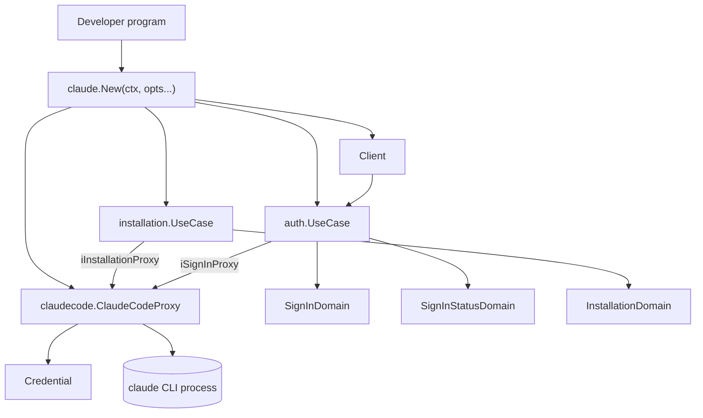

# Claude Code Sign-in and Profiles — Architecture Design

**Status:** Confirmed
**Source PRD:** `.sdd/2026-11-26-cli-auth-profiles/PRD.md`
**Tech context:** Go 1.23+ library · library-by-feature (`.claude/rules/architecture.md`) · standard library only in production, testify in tests

---

## 1. Design Goal & Guiding Principle

- **In one sentence:** let a Go program build a `claude.Client` that verifies the local Claude Code CLI, then read / start / end the CLI's sign-in under an optional isolated profile or a supplied credential — without the library ever touching stored secrets.
- **Guiding principle:** **every CLI invocation goes through one `ClaudeCodeProxy` that owns process launching, environment (profile + credential), cancellation and secret redaction.** Features only see VOs and feature errors. The next feature (sending prompts) adds one interface and one proxy method; it inherits profile, credential, cancellation and redaction for free.

---

## 2. Change Scope

Greenfield: everything is added.

| Area | Action | What / Why |
| :--- | :--- | :--- |
| `go.mod` (`github.com/CodeMachine0121/go-claude`, Go 1.23) | **Add** | Module root |
| Root package `claude` | **Add** | Composition root: options, credential conflict check, wiring, `Client` facade |
| `installation/` | **Add** | Feature: locate Claude Code and enforce the oldest supported release. Its own package because "Claude Code is missing / too old" is shared by every future feature |
| `auth/` | **Add** | Feature: sign-in state, sign-in, sign-out |
| `internal/infrastructure/claudecode/` | **Add** | `ClaudeCodeProxy` + `Credential`: the only code that runs the CLI |
| `test/` | **Add** | Integration tests against the real CLI |
| `README.md`, `examples/signin/` | **Add** | Public usage docs incl. the compliance note |
| `.claude/rules/testing.md` | **Modify** | Allow unit tests of pure wire decoding / redaction inside infrastructure using recorded real CLI output (no fakes involved) |
| Prompt sending, conversations, tool permissions | **Not touched** | Later iterations; the proxy seam is prepared for them |
| Installing / updating Claude Code | **Not touched** | Out of scope; we only report and point to the install command |

---

## 3. New Classes / Modules

### Root package `claude`

| Name | Kind | Responsibility (purpose) | Collaborators | Satisfies |
| :--- | :--- | :--- | :--- | :--- |
| `New(ctx, opts ...Option) (*Client, error)` | Composition root | Apply options, reject conflicting credentials, build `ClaudeCodeProxy`, verify the installation, wire use cases | `claudecode.ClaudeCodeProxy`, `installation.UseCase`, `auth.UseCase` | US-01 all, US-06 "both kinds" |
| `Client` | Facade | Hold the verified installation and expose features: `Installation() installation.InstallationDto`, `Auth() *auth.UseCase` | — | US-01 "found automatically", "exactly the oldest" |
| `Option` + `WithCLIPath`, `WithProfile`, `WithOAuthToken`, `WithAPIKey`, `WithTerminal` | Functional options | Collect settings; `WithTerminal(in, out, errOut)` redirects the interactive sign-in (defaults to the process's std streams) | `settings` (unexported) | US-01 "chosen copy", US-05, US-06 |
| `ErrConflictingCredentials`, `ErrInvalidOption` | Sentinel errors | "supply only one kind of credential"; empty path / profile | — | US-06 "both kinds" |

### `installation/`

| Name | Kind | Responsibility | Collaborators | Satisfies |
| :--- | :--- | :--- | :--- | :--- |
| `UseCase.Verify(ctx) (InstallationDto, error)` | Use case | One call: inspect the CLI and refuse when missing or too old | `iInstallationProxy` | US-01 all |
| `iInstallationProxy.Inspect(ctx) (InstallationVo, error)` | Unexported interface | Capability: report where Claude Code is and which release it is | implemented by `ClaudeCodeProxy` | US-01 |
| `VersionVo` + `NewVersionVo(text) (VersionVo, error)` | VO | Parse "2.1.332 (Claude Code)" → major/minor/patch; `AtLeast(other) bool`; `String()` | — | US-01 boundary / too old |
| `InstallationVo` → `ToDomain()` | VO | Path + `VersionVo` handed in by the proxy | — | US-01 |
| `InstallationDomain.Verify() error`, `ToDto()` | Domain model | Enforce `MinimumSupportedVersion` (2.1.0) | `VersionVo` | US-01 boundary / too old |
| `InstallationDto{Path, Version string}` | DTO | Public shape returned by `Client.Installation()` | — | US-01 happy / boundary |
| `ErrNotInstalled`, `ErrUnrecognizedVersion`, `UnsupportedVersionError{Found, Required}` (unwraps to `ErrUnsupportedVersion`) | Errors | Refusals; the not-installed message includes the install command | — | US-01 exceptions |

### `auth/`

| Name | Kind | Responsibility | Collaborators | Satisfies |
| :--- | :--- | :--- | :--- | :--- |
| `UseCase.Status(ctx) (StatusDto, error)` | Use case | Read the sign-in state | `iSignInProxy` | US-02, US-05, US-06 |
| `UseCase.Login(ctx, LoginRequest) (StatusDto, error)` | Use case | Validate the method, run the interactive sign-in, then **read the state back**; exit OK but still signed out ⇒ `ErrSignInNotCompleted`. One call = one business action | `iSignInProxy`, `SignInDomain` | US-03 |
| `UseCase.Logout(ctx) error` | Use case | End the sign-in; already signed out is success | `iSignInProxy` | US-04, US-05 |
| `iSignInProxy` — `ReadStatus(ctx) (StatusVo, error)`, `SignIn(ctx, SignInVo) error`, `SignOut(ctx) error` | Unexported interface | Capability: the CLI's sign-in operations | implemented by `ClaudeCodeProxy` | US-02..05 |
| `SignInMethod` (bit flags: `ClaudeSubscription`, `DeveloperAccount`, `SingleSignOn`; zero = default) | Enum | Lets a caller express a combination so it can be refused | — | US-03 |
| `LoginRequest{Method, Email}` | Request | Public input | — | US-03 |
| `SignInDomain` (`NewSignInDomain(request)`, `ToVo()`) | Domain model | Default zero → Claude subscription; more than one flag ⇒ `ErrMultipleSignInMethods` | — | US-03 default / two methods |
| `SignInVo{Method, Email}` | VO | Validated sign-in handed to the proxy | — | US-03 |
| `StatusVo{LoggedIn, AuthMethod, SubscriptionType, ExpiresAt, Email, OrganizationName}` → `ToDomain()` | VO | Normalized CLI answer | — | US-02 |
| `SignInStatusDomain` → `ToDto()` | Domain model | Map the raw auth method to `AccountKind`; unknown names kept verbatim; not signed in ⇒ `AccountKindNotSignedIn` | — | US-02, US-06 |
| `AccountKind` (`ClaudeSubscription`, `DeveloperAccount`, `SubscriptionPass`, `DeveloperAccountKey`, `NotSignedIn`, or the raw name) | Enum | Public account kind | — | US-02, US-06 |
| `StatusDto{SignedIn, AccountKind, Plan, ExpiresAt, Email, Organization}` | DTO | Public sign-in state | — | US-02 |
| `ErrSignInNotCompleted`, `ErrMultipleSignInMethods`, `UnreadableStatusError{Output}` (unwraps to `ErrUnreadableStatus`) | Errors | Failures | — | US-02 unreadable, US-03 exceptions |

### `internal/infrastructure/claudecode/`

| Name | Kind | Responsibility | Collaborators | Satisfies |
| :--- | :--- | :--- | :--- | :--- |
| `ClaudeCodeProxy` (`NewClaudeCodeProxy(Settings)`) | Proxy | Implements `installation.iInstallationProxy` and `auth.iSignInProxy`. One unexported `run` path builds every command: resolved path, environment, `exec.CommandContext` with `WaitDelay` 1s, cancellation → wrapped `ctx.Err()`, missing binary → `installation.ErrNotInstalled`, every error text passed through `Credential.Redact` | `Credential`, `os/exec` | all |
| `Settings{CLIPath, ProfileDirectory, Credential, Stdin, Stdout, Stderr}` | Settings struct | What the composition root hands the proxy | — | US-01, US-05, US-06 |
| Path resolution | Proxy method | Chosen path: must exist, never fall back. Otherwise `exec.LookPath("claude")` | — | US-01 chosen / missing |
| Environment | Proxy method | Inherit the process env; profile ⇒ `CLAUDE_CONFIG_DIR`; credential ⇒ set its variable **and remove the other credential variable** | `Credential` | US-05, US-06 |
| `Credential` (`NewOAuthToken`, `NewAPIKey`) | Value type | Holds one secret; `EnvironmentVariable()`, `Redact(text) string`, `String()` / `GoString()` return `[REDACTED]` | — | US-06 secret hidden |
| `statusPayload` → `ToVo()` | Wire struct | Decode `claude auth status` JSON (its exit code is 1 when signed out — the payload, not the exit code, is authoritative) | `auth.StatusVo` | US-02 |

> Each use case is one call per business action; callers never sequence steps.

---

## 4. Modified Components

| Component | Current role | Change needed |
| :--- | :--- | :--- |
| `.claude/rules/testing.md` | Forbids unit tests of proxies | Permit unit tests of **pure** functions inside infrastructure (wire decoding, redaction) fed with recorded real CLI output; process I/O still integration-only |

---

## 5. Component Relationships

---

## 6. Extensibility & Handoff Notes

- **Most likely next requirement:** send a prompt and stream the reply (next iteration), then multi-turn sessions.
- **Where it lands:** a new feature package (`query/`) defining its own unexported proxy interface; `ClaudeCodeProxy` gains one method built on the same `run` path; `New` wires one more use case and `Client` gets one more accessor.
- **How to add it:** add-only. Profile, credential, cancellation, redaction and "not installed" handling are inherited from the proxy's single command path — never re-implement them in a feature.
- **Patterns applied & why:** consumer-defined interfaces (each feature mocks only what it uses); functional options (new settings never break `New`'s signature); value-carrying error types (callers branch with `errors.Is/As`, messages can evolve).
- **Do not hardcode:** the binary name / path (option), the minimum release (one exported constant), environment variable names (only in infrastructure), terminal streams (option).
- **Known debt / deferred:** the developer-account auth method string is unobserved; it is mapped as `console` and unknown values pass through. Revisit when a real value is seen.

---

## 7. Traceability

| PRD Scenario | Fulfilled by |
| :--- | :--- |
| US-01 Claude Code is found automatically | `ClaudeCodeProxy` path lookup + `installation.UseCase.Verify` → `Client.Installation()` |
| US-01 The developer's chosen copy is used | `WithCLIPath` → `ClaudeCodeProxy` path resolution |
| US-01 Exactly the oldest supported release is accepted | `InstallationDomain.Verify` + `VersionVo.AtLeast` |
| US-01 A release older than supported is refused | `InstallationDomain.Verify` → `UnsupportedVersionError{Found, Required}` |
| US-01 Claude Code is missing | `ClaudeCodeProxy` → `installation.ErrNotInstalled` (message carries install command) |
| US-01 The chosen copy does not exist | `ClaudeCodeProxy` path resolution (no fallback) → `ErrNotInstalled` |
| US-02 Signed in with a Claude subscription | `statusPayload.ToVo` → `SignInStatusDomain.ToDto` (`AccountKindClaudeSubscription`, plan, expiry) |
| US-02 Signed in with a developer account | `SignInStatusDomain` mapping → `AccountKindDeveloperAccount` |
| US-02 Not signed in is an ordinary answer | `ClaudeCodeProxy.ReadStatus` (payload over exit code) + `SignInStatusDomain` → `AccountKindNotSignedIn`, nil error |
| US-02 An unfamiliar account kind is kept | `SignInStatusDomain` passes unknown names through as `AccountKind` |
| US-02 Claude Code's answer cannot be understood | `ClaudeCodeProxy.ReadStatus` → `UnreadableStatusError{Output}` |
| US-02 The developer gives up waiting | `ClaudeCodeProxy.run` (`CommandContext`, `WaitDelay`) → wrapped `context.Canceled` |
| US-03 Sign in with a Claude subscription by default | `SignInDomain` default + `auth.UseCase.Login` (reads state back) |
| US-03 Sign in with a developer account and a pre-filled email | `SignInVo` → `ClaudeCodeProxy.SignIn` (`--console --email`) |
| US-03 Sign in with company single sign-on | `SignInVo` → `ClaudeCodeProxy.SignIn` (`--sso`) |
| US-03 The person does not finish signing in | `auth.UseCase.Login` → `ErrSignInNotCompleted` (CLI failure, or still signed out afterwards) |
| US-03 More than one sign-in method is chosen | `SignInDomain` → `ErrMultipleSignInMethods`; proxy never called |
| US-03 The developer gives up on the sign-in | `ClaudeCodeProxy.run` cancellation → wrapped `context.Canceled` |
| US-04 Sign out when signed in | `auth.UseCase.Logout` → `ClaudeCodeProxy.SignOut` |
| US-04 Sign out when already signed out | `auth.UseCase.Logout` (CLI succeeds; nil error) |
| US-05 No profile means the everyday sign-in | `ClaudeCodeProxy` environment (no `CLAUDE_CONFIG_DIR` override) |
| US-05 A profile has its own sign-in | `WithProfile` → `CLAUDE_CONFIG_DIR` in `ClaudeCodeProxy` environment |
| US-05 Signing out of a profile leaves the everyday sign-in alone | `WithProfile` + `auth.UseCase.Logout` |
| US-05 A new profile starts signed out | `WithProfile` + `auth.UseCase.Status` → not signed in |
| US-06 A subscription pass is used without an interactive sign-in | `WithOAuthToken` → `Credential` env → `AccountKindSubscriptionPass` |
| US-06 A developer account key is used | `WithAPIKey` → `Credential` env → `AccountKindDeveloperAccountKey` |
| US-06 Both kinds of credential are handed over | `claude.New` → `ErrConflictingCredentials` |
| US-06 A failure never repeats the handed-over secret | `Credential.Redact` applied in `ClaudeCodeProxy.run` to every error text |

---

## 8. Risks & Open Decisions

- **Risks / trade-offs:**
  - `New` runs `claude --version`, so constructing a client costs one process launch; accepted for early, clear failure.
  - Sign-in is interactive and cannot be integration-tested unattended; covered by use-case tests with mocks, plus a manual example program.
  - Integration tests that need the person's everyday sign-in skip when signed out.
- **Open decisions (for implementation):** none blocking. Minimum release fixed at 2.1.0; module path `github.com/CodeMachine0121/go-claude`.
