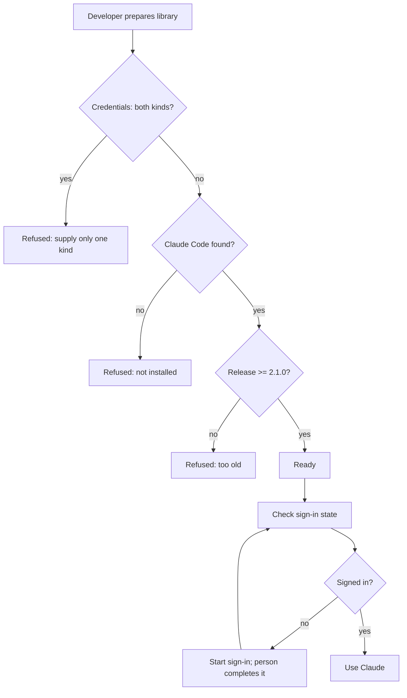

# Product Requirements Document (PRD)

**Status:** Finalized
**Version:** v1.0
**Owner:** CodeMachine0121
**Stakeholders:** Library maintainers, open-source developers who build on the library

---

## 1. Background & Goal (Why & Goal)

- **Problem Statement:** Developers who want their Go programs to use Claude through the person's existing Claude Code sign-in (including a Claude subscription) have no dependable way to know whether Claude Code is available, whether the person is signed in and how, or to guide the person through signing in and out — and no way to keep several sign-ins apart.
- **Expected Outcome:**
  - A developer can, in a handful of lines, confirm Claude Code is ready, read the sign-in state, and start a sign-in or sign-out.
  - Several profiles can be used side by side without disturbing each other or the person's everyday sign-in.
  - Unattended programs run with a supplied subscription pass or developer account key, and that secret never shows up in anything the library reports.
  - Every situation in Section 3 is covered by an automated check.
- **Out of Scope:**
  - Sending requests to Claude and reading replies (next iteration).
  - Multi-turn conversations, interrupting and resuming them (later iteration).
  - Tool permissions, extensions and other custom behaviors of Claude Code.
  - Installing or updating Claude Code for the person.
  - Any sign-in that bypasses Claude Code.

---

## 2. User Personas

- **Primary Role(s):**
  - **Developer** — writes the Go program and calls the library.
  - **Person** — runs the developer's program and owns the Claude sign-in.
- **Usage Context:**
  - Interactive: the person runs the program on their own computer, in a terminal, with a browser available for signing in.
  - Unattended: the program runs on a server or in automation with no one present, using a supplied subscription pass or developer account key.

---

## 3. User Stories & Acceptance Criteria

### US-01 — Locate Claude Code [priority: P0]
**As a** developer, **I want** the library to find the person's Claude Code and confirm it is recent enough, **so that** my program fails early with a clear reason instead of misbehaving later.

The oldest supported Claude Code release is **2.1.0**.

```gherkin
Scenario: Claude Code is found automatically
  Given Claude Code release 2.1.332 is set up on the person's computer
  And the developer has not pointed to a particular copy
  When the developer prepares the library for use
  Then preparation succeeds with no refusal
  And the library reports release 2.1.332 as the Claude Code in use

Scenario: The developer's chosen copy is used
  Given the developer points to a particular copy of Claude Code that exists
  And another copy is also set up on the person's computer
  When the developer prepares the library for use
  Then the chosen copy is the one used

Scenario: Exactly the oldest supported release is accepted
  Given the person's Claude Code is release 2.1.0
  When the developer prepares the library for use
  Then preparation succeeds with no refusal
  And the library reports release 2.1.0 as the Claude Code in use

Scenario: A release older than supported is refused
  Given the person's Claude Code is release 2.0.9
  When the developer prepares the library for use
  Then preparation is refused as "Claude Code is too old"
  And the refusal names release 2.0.9 as found and 2.1.0 as required

Scenario: Claude Code is missing
  Given Claude Code is not set up on the person's computer
  When the developer prepares the library for use
  Then preparation is refused as "Claude Code is not installed"
  And the refusal tells the developer how to get Claude Code

Scenario: The chosen copy does not exist
  Given the developer points to a copy of Claude Code that does not exist
  And another copy is set up on the person's computer
  When the developer prepares the library for use
  Then preparation is refused as "Claude Code is not installed"
  And the other copy is not used instead
```

### US-02 — Check sign-in state [priority: P0]
**As a** developer, **I want** to read whether the person is signed in, how, on which plan and until when, **so that** my program can decide whether to ask the person to sign in.

```gherkin
Scenario: Signed in with a Claude subscription
  Given the person is signed in with a Claude subscription on the team plan
  And the sign-in expires on 24 December 2026
  When the developer checks the sign-in state
  Then the state reads signed in, account kind "Claude subscription", plan "team", expiring 24 December 2026

Scenario: Signed in with a developer account
  Given the person is signed in with a pay-per-use developer account
  When the developer checks the sign-in state
  Then the state reads signed in, account kind "developer account"

Scenario: Not signed in is an ordinary answer
  Given the person has never signed in
  When the developer checks the sign-in state
  Then the state reads not signed in
  And no failure is reported

Scenario: An unfamiliar account kind is kept
  Given Claude Code reports the person is signed in with an account kind the library does not recognise
  When the developer checks the sign-in state
  Then the state reads signed in, with that account kind's name as Claude Code reported it

Scenario: Claude Code's answer cannot be understood
  Given Claude Code answers the sign-in question with something unreadable
  When the developer checks the sign-in state
  Then the check fails as "could not read sign-in state"
  And the failure includes what Claude Code said

Scenario: The developer gives up waiting
  Given Claude Code has not yet answered
  When the developer gives up on checking the sign-in state
  Then the check stops right away
  And it is reported as given up
```

### US-03 — Sign in [priority: P0]
**As a** developer, **I want** to start a sign-in that the person completes themselves through Claude Code, **so that** my program never handles the person's password or secrets.

```gherkin
Scenario: Sign in with a Claude subscription by default
  Given the person is not signed in
  And the developer has not chosen a sign-in method
  When the developer starts a sign-in
  Then Claude Code guides the person through signing in with a Claude subscription in their own terminal and browser
  And afterwards the sign-in state reads signed in

Scenario: Sign in with a developer account and a pre-filled email
  Given the developer chooses the developer account method and the email "dev@example.com"
  When the developer starts a sign-in
  Then Claude Code guides the person through a developer account sign-in with "dev@example.com" already filled in

Scenario: Sign in with company single sign-on
  Given the developer chooses the company single sign-on method
  When the developer starts a sign-in
  Then Claude Code guides the person through company single sign-on

Scenario: The person does not finish signing in
  Given a sign-in has started
  When the person closes it without finishing
  Then the sign-in fails as "sign-in was not completed"

Scenario: More than one sign-in method is chosen
  Given the developer chooses both the developer account method and company single sign-on
  When the developer starts a sign-in
  Then the sign-in is refused as "choose one sign-in method"
  And Claude Code is not asked to start anything

Scenario: The developer gives up on the sign-in
  Given a sign-in has started
  When the developer gives up on it
  Then the sign-in is stopped
  And it is reported as given up
```

### US-04 — Sign out [priority: P1]
**As a** developer, **I want** to sign the person out, **so that** my program can offer a clean "switch account" or "forget me".

```gherkin
Scenario: Sign out when signed in
  Given the person is signed in
  When the developer signs the person out
  Then the sign-in state reads not signed in

Scenario: Sign out when already signed out
  Given the person is not signed in
  When the developer signs the person out
  Then the sign-out succeeds
  And no failure is reported
```

### US-05 — Separate profiles [priority: P0]
**As a** developer, **I want** to keep several named profiles, each with its own sign-in and conversation history, **so that** my program can work with different accounts without touching the person's everyday sign-in.

```gherkin
Scenario: No profile means the everyday sign-in
  Given the person's everyday sign-in is account A
  And the developer has not chosen a profile
  When the developer checks the sign-in state
  Then the state reports account A

Scenario: A profile has its own sign-in
  Given profile "work" is signed in as account B
  And the person's everyday sign-in is account A
  When the developer checks the sign-in state under profile "work"
  Then the state reports account B
  And the everyday sign-in still reports account A

Scenario: Signing out of a profile leaves the everyday sign-in alone
  Given profile "work" is signed in
  And the person's everyday sign-in is signed in
  When the developer signs out under profile "work"
  Then profile "work" reads not signed in
  And the everyday sign-in still reads signed in

Scenario: A new profile starts signed out
  Given profile "fresh" has never been used
  When the developer checks the sign-in state under profile "fresh"
  Then the state reads not signed in
  And no failure is reported
```

### US-06 — Ready-made credentials for unattended use [priority: P0]
**As a** developer, **I want** to hand over a subscription pass or a developer account key, **so that** my program can run with no one present to sign in.

```gherkin
Scenario: A subscription pass is used without an interactive sign-in
  Given the developer hands over a subscription pass
  When the developer checks the sign-in state
  Then the state reads signed in, account kind "subscription pass"
  And no sign-in was started

Scenario: A developer account key is used
  Given the developer hands over a developer account key
  When the developer checks the sign-in state
  Then the state reads signed in, account kind "developer account key"

Scenario: Both kinds of credential are handed over
  Given the developer hands over both a subscription pass and a developer account key
  When the developer prepares the library for use
  Then preparation is refused as "supply only one kind of credential"

Scenario: A failure never repeats the handed-over secret
  Given the developer hands over the subscription pass "sk-ant-oat01-SECRET"
  And Claude Code reports a failure whose text contains "sk-ant-oat01-SECRET"
  When the failure reaches the developer
  Then the failure does not contain "sk-ant-oat01-SECRET"
  And the place where it appeared is marked as hidden
```

---

## 4. Business Flow & Logic

- **Flow Diagram:**



- **Core Business Rules:**
  - The oldest supported Claude Code release is 2.1.0; releases are compared part by part (major, minor, patch).
  - A chosen copy of Claude Code is used as-is; when it does not exist, no other copy is tried.
  - "Not signed in" is a state, never a failure — for checking and for signing out.
  - Exactly one sign-in method per sign-in; the Claude subscription is the default.
  - At most one kind of credential may be handed over.
  - A profile isolates sign-in and conversation history; no profile means the everyday sign-in.
  - A handed-over secret is hidden wherever it would otherwise appear in what the library reports.
  - Unrecognised account kinds are reported by the name Claude Code gave, not rejected.
  - The library never reads the person's saved sign-in secrets and never signs in on its own.
- **Edge Cases:**
  - Developer gives up mid-operation → the operation stops right away, reported as given up.
  - Claude Code answers with something unreadable → "could not read sign-in state", including what it said.
  - Person abandons the sign-in → "sign-in was not completed".
  - Claude Code disappears between preparation and use → "Claude Code is not installed".

---

## 5. UI/UX Design & Interaction

- **Prototype Link:** N/A — the library has no screens of its own.
- **Key Interactions:**
  - The sign-in is shown by Claude Code itself in the person's terminal and browser; the library only starts it and waits.
  - Refusals and failures read as short plain sentences a developer can show to the person as-is.

---

## 6. Non-Functional Requirements

- **Performance:** Checking the sign-in state adds no noticeable delay beyond Claude Code's own answer time. Giving up stops an operation within one second.
- **Security:**
  - Handed-over secrets never appear in failures, refusals or descriptions of the library's settings.
  - The library never reads saved sign-in secrets and never performs its own sign-in.
  - Account identity details (email, organisation) are available to the developer but never included in failures.
- **Compatibility:** macOS, Linux and Windows wherever Claude Code 2.1.0 or later runs; the two most recent Go releases.
- **Dependencies:** The library adds no third-party dependencies to the developer's program.
- **Analytics / Tracking:** None. The library collects and sends nothing.

---

## 7. Dependencies & Risks

- **External Dependencies:** Claude Code 2.1.0 or later on the person's computer.
- **Known Risks:**
  - Claude Code may change how it describes the sign-in state; mitigated by tolerating unknown account kinds and reporting unreadable answers clearly.
  - The value Claude Code uses for a developer-account sign-in has not been observed yet.
  - **Compliance:** a person using their own Claude subscription on their own computer is fine. A product that offers Claude account sign-in to its own end users needs prior approval from Anthropic; otherwise it must use a developer account key. The public documentation must say so.

---

## 8. Appendix

- Requirements brief: `BRIEF.md` in this folder.
- Domain vocabulary: `.sdd/UL-MAP.md`.
- Observed Claude Code 2.1.332 behaviour: the sign-in question is answered in full even when not signed in; signing out when already signed out succeeds; a new profile location is set up on first use.
