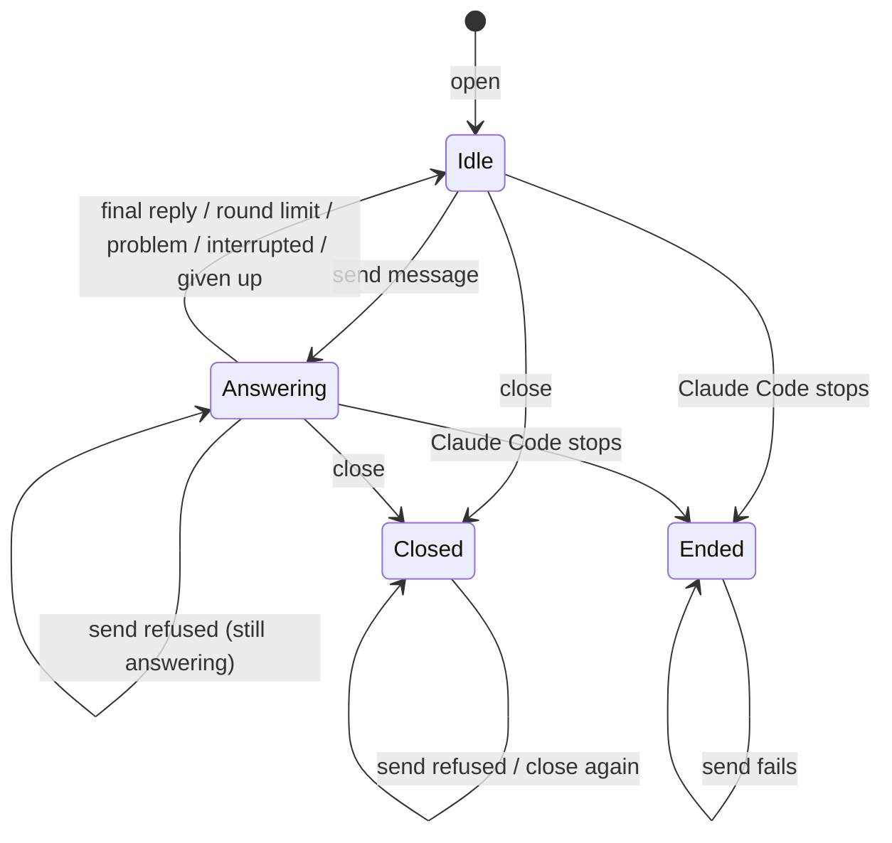

# Product Requirements Document (PRD)

**Status:** Finalized
**Version:** v1.0
**Owner:** CodeMachine0121
**Stakeholders:** Library maintainers, open-source developers who build on the library

---

## 1. Background & Goal (Why & Goal)

- **Problem Statement:** One-shot requests start Claude Code afresh every time; continuing means starting again with an earlier reference. Chat-like programs need a conversation that stays open, answers message after message, and can be interrupted while Claude writes.
- **Expected Outcome:**
  - One call opens a conversation; each message returns one final reply; Claude remembers the conversation.
  - The developer can interrupt a reply or give up on it and keep talking.
  - Each reply reports its own cost; the conversation reports the running total.
  - Every situation in Section 3 is covered by an automated check.
- **Out of Scope:** partial text while Claude writes; asking the person for permission during a reply; several messages answered at once; choosing which of the person's Claude Code settings apply.

---

## 2. User Personas

- **Developer** — builds chat-like tools, assistants and long-running agents on the library.
- **Person** — runs the program; their sign-in, pass or key pays for the conversation.
- **Usage Context:** interactive programs and services that keep talking to Claude over minutes or hours.

---

## 3. User Stories & Acceptance Criteria

### US-01 — Talk in one conversation [priority: P0]
**As a** developer, **I want** to send several messages in one open conversation, **so that** Claude keeps the context without starting over.

```gherkin
Scenario: Claude remembers earlier messages
  Given an open conversation
  When the developer sends "Reply with exactly: ONE"
  And then sends "What did you just reply? One word."
  Then the first reply text is "ONE"
  And the second reply text contains "ONE"

Scenario: An empty message is refused
  Given an open conversation
  When the developer sends a message that is only spaces
  Then it is refused as "the request is empty"
  And the next message is answered normally

Scenario: A second message while Claude is still answering is refused
  Given Claude is still answering a message
  When the developer sends another message
  Then it is refused as "still answering"
  And the first reply still arrives
```

### US-02 — Interrupt or give up [priority: P0]
**As a** developer, **I want** to stop a reply Claude is writing and keep talking, **so that** a person can change their mind without losing the conversation.

```gherkin
Scenario: Interrupting a long reply
  Given Claude is writing a long essay
  When the developer interrupts
  Then the essay message fails as "interrupted"
  And the next message "Reply with exactly: AFTER" gets the reply "AFTER"

Scenario: Interrupting when Claude is idle does nothing
  Given Claude is not answering anything
  When the developer interrupts
  Then no failure is reported
  And the next message is answered normally

Scenario: Giving up on one message keeps the conversation
  Given Claude is writing a long essay
  When the developer gives up on that message
  Then it is reported as given up within one second
  And the next message "Reply with exactly: AFTER" gets the reply "AFTER"
```

### US-03 — Account for each reply [priority: P0]
**As a** developer, **I want** each reply's own cost and the running total, **so that** I can bill or limit per message.

```gherkin
Scenario: A later reply costs the increase in the total
  Given the conversation has cost 0.0038563 dollars so far
  When Claude Code states a total of 0.00612419 dollars with the second reply
  Then that reply's cost reads "0.00226789"
  And the conversation's total reads "0.00612419"

Scenario: The first reply costs the whole total
  Given a new conversation
  When Claude Code states a total of 0.0038563 dollars with the first reply
  Then that reply's cost reads "0.0038563"
  And the conversation's total reads "0.0038563"
```

### US-04 — End a conversation [priority: P0]
**As a** developer, **I want** closing to end Claude Code's work cleanly, **so that** nothing keeps running or spending.

```gherkin
Scenario: Closing ends Claude Code's work
  Given an open conversation
  When the developer closes it
  Then Claude Code is no longer running for it
  And closing it again reports no failure

Scenario: Sending after closing is refused
  Given a closed conversation
  When the developer sends a message
  Then it is refused as "the conversation is closed"

Scenario: Claude Code stopping on its own ends the conversation
  Given Claude Code stopped on its own
  When the developer sends a message
  Then it fails as "the conversation ended"
  And every later message fails as "the conversation ended"
```

### US-05 — Open with choices or continue [priority: P1]
**As a** developer, **I want** the same choices as one-shot requests and the ability to continue, **so that** both ways of asking behave alike.

```gherkin
Scenario: Continuing an earlier conversation
  Given an earlier conversation in which Claude replied "OK"
  When the developer opens it again and asks "What did you just reply? One word."
  Then the reply text contains "OK"

Scenario: An unknown earlier conversation
  Given a conversation reference that never existed
  When the developer opens it and sends a message
  Then it fails as "conversation not found"

Scenario: A negative round cap is refused
  Given a round limit of -1
  When the developer opens a conversation
  Then it is refused as "the round limit cannot be negative"

Scenario: A work folder that does not exist is refused
  Given a project folder that does not exist
  When the developer opens a conversation
  Then it is refused as "the work folder does not exist"

Scenario: A person who is not signed in
  Given the person is not signed in and no pass or key was handed over
  When the developer sends a message in a new conversation
  Then it fails as "not signed in"
  And the conversation stays open
```

---

## 4. Business Flow & Logic



- **Core Business Rules:**
  - One message is answered at a time.
  - The round cap applies to each message; 0 means none; negative is refused when opening.
  - A reply's cost is the increase of the conversation's total; the first reply costs the whole total; a total that went down (Claude Code restarted counting) makes the reply cost the new total.
  - Interrupting affects only the reply being written; when idle it does nothing.
  - Giving up on a message interrupts it and reports it as given up; if Claude Code does not settle within one second, the conversation ends.
  - Closing ends Claude Code's work, including commands Claude started; it is harmless to repeat.
  - Every failure that a one-shot request recognises (empty, round limit, not signed in, problem, unknown conversation, missing work folder) is recognised per message the same way.
  - Handed-over secrets are hidden in every text that reaches the developer.
- **Edge Cases:** Claude Code stops on its own → "the conversation ended" from then on; an answer that cannot be understood is ignored unless it is a final answer.

---

## 5. UI/UX Design & Interaction

N/A — no screens. Failures read as short plain sentences.

---

## 6. Non-Functional Requirements

- **Performance:** a message costs no process start; giving up returns within one second.
- **Security:** secrets never appear in failures; nothing is logged.
- **Compatibility:** as previous iterations; very long messages work on every platform.
- **Concurrency:** a conversation may be used from several goroutines; sends are serialised by refusal, interrupts may come from any goroutine.
- **Dependencies:** none beyond the standard library in production code.

---

## 7. Dependencies & Risks

- Claude Code's conversation protocol is newer than its one-shot mode and may change; the library tolerates unknown message kinds.
- The person's own Claude Code settings (including prompt hooks) apply inside the conversation; documentation must say so.
- Integration checks that reach Claude use the person's usage; they are opt-in.

---

## 8. Appendix

- Requirements brief: `BRIEF.md` in this folder; previous iterations under `.sdd/`.
- Decision: conversations live with one-shot requests (same feature), sharing replies, costs and failures.
- Observed Claude Code 2.1.332: per message, an initialisation notice, assistant messages and a final answer; the final answer's cost is the running total; an interrupt is acknowledged and the reply ends `error_during_execution` / `aborted_streaming`; closing the input ends Claude Code with success.
