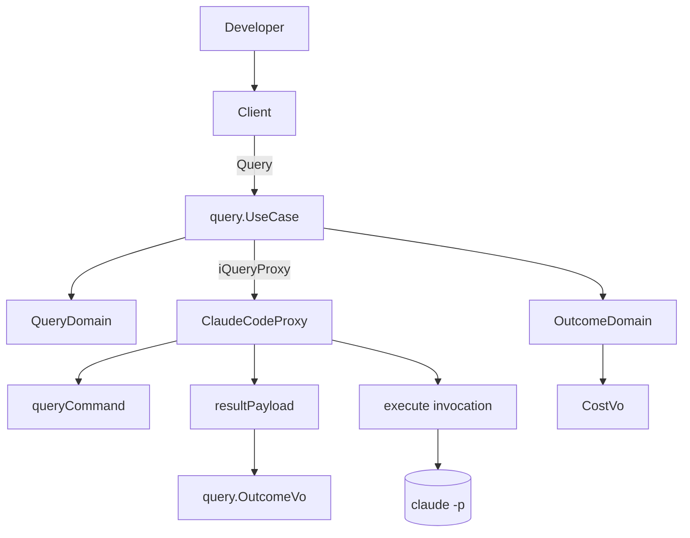

# One-shot Request — Architecture Design

**Status:** Confirmed
**Source PRD:** `.sdd/2026-11-26-one-shot-query/PRD.md`
**Tech context:** Go 1.23+ library · library-by-feature (`.claude/rules/architecture.md`) · builds on `.sdd/2026-11-26-cli-auth-profiles/ARCH.md`

---

## 1. Design Goal & Guiding Principle

- **In one sentence:** `client.Query().Ask(ctx, query.Request)` runs `claude -p --output-format json` once, with the request on standard input, and turns Claude Code's final answer into a `query.ResultDto` or a recognisable failure.
- **Guiding principle:** **the proxy normalizes Claude Code's answer into an outcome VO; the domain alone decides what each outcome means for the developer.** Wire details (flags, JSON field names, Claude's wording for "not logged in") stay in infrastructure; the rules ("round limit reached still reports cost", "zero means no limit") live in `query`.

---

## 2. Change Scope

| Area | Action | What / Why |
| :--- | :--- | :--- |
| `query/` | **Add** | Feature package: request validation, outcome interpretation, cost value |
| `internal/infrastructure/claudecode/` | **Modify** | `ClaudeCodeProxy.Ask` + `resultPayload` decoding; `execute` learns to feed standard input and run in a work folder |
| Root `client.go` | **Modify** | Wire `query.UseCase`; add `Client.Query()` |
| `test/query_test.go` | **Add** | Integration tests; the ones that consume usage are opt-in (`GO_CLAUDE_LIVE_TESTS=1`) |
| `README.md`, `CONTRIBUTING.md`, `examples/ask/` | **Modify / Add** | Usage, the warning about allowed actions, how to run usage-consuming tests |
| `auth/`, `installation/` | **Not touched** | Their behavior is unchanged |
| Streaming / multi-turn | **Not touched** | Out of scope; next iteration |

---

## 3. New Classes / Modules

### `query/`

| Name | Kind | Responsibility (purpose) | Collaborators | Satisfies |
| :--- | :--- | :--- | :--- | :--- |
| `UseCase.Ask(ctx, Request) (ResultDto, error)` | Use case | One call per request: validate, hand to Claude Code, interpret the outcome | `iQueryProxy`, `QueryDomain`, `OutcomeVo` | all |
| `iQueryProxy.Ask(ctx, QueryVo) (OutcomeVo, error)` | Unexported interface | Capability: run one request through Claude Code | implemented by `ClaudeCodeProxy` | all |
| `Request{Prompt, MaxTurns, Model, WorkingDirectory, AllowedTools, SessionID}` | Request | Public input. `MaxTurns` 0 = no limit | — | US-01..04 |
| `QueryDomain` (`NewQueryDomain(Request)`, `ToVo()`) | Domain model | Refuse empty prompt (`ErrEmptyRequest`) and negative limit (`ErrNegativeMaxTurns`) | — | US-01 empty, US-02 negative |
| `QueryVo` | VO | Validated request handed to the proxy | — | — |
| `OutcomeVo{Kind, Text, Turns, SessionID, Cost, Explanation}` → `ToDomain()` | VO | Normalized final answer. `Kind`: finished / round limit reached / not signed in / problem | — | US-01..06 |
| `OutcomeDomain.ToDto() (ResultDto, error)` | Domain model | finished ⇒ `ResultDto`; round limit ⇒ `*RoundLimitError{Turns, CostUSD, SessionID}`; not signed in ⇒ `ErrNotSignedIn`; problem ⇒ `*ProblemError{Explanation}` | `CostVo` | US-02 cap, US-03 model, US-06 not signed in |
| `CostVo` (`NewCostVo(text)`, `String()`, `Nanodollars()`) | VO | Exact US-dollar amount in billionths (int64), parsed from Claude Code's decimal text; digits beyond the billionth dropped; never float | — | US-05 |
| `ResultDto{Text, Turns, SessionID, CostUSD, CostNanodollars}` | DTO | Public reply | — | US-01, US-05 |
| Errors: `ErrEmptyRequest`, `ErrNegativeMaxTurns`, `ErrWorkFolderMissing`, `ErrNotSignedIn`, `ErrConversationNotFound`, `ErrRoundLimitReached` (+ `*RoundLimitError`), `ErrClaudeReportedProblem` (+ `*ProblemError`), `ErrUnreadableReply` (+ `*UnreadableReplyError`), `ErrInvalidCost` | Errors | Recognisable failures | — | all exceptions |

### `internal/infrastructure/claudecode/`

| Name | Kind | Responsibility | Satisfies |
| :--- | :--- | :--- | :--- |
| `ClaudeCodeProxy.Ask(ctx, QueryVo)` | Proxy method | Refuse a missing work folder before running; run `claude -p --output-format json [--max-turns N] [--model M] [--allowedTools a,b] [--resume id]` with the prompt on standard input, in the work folder; decode; "No conversation found" ⇒ `ErrConversationNotFound`; undecodable ⇒ `*UnreadableReplyError` | US-01..06 |
| `invocation{arguments, terminal, input, directory}` | Value | What `execute` runs. Replaces the `terminal bool, arguments...` parameters so new needs (input, folder) are fields, not parameters | — |
| `queryCommand{query QueryVo}.arguments()` | Pure builder | Flags from the request; no `--max-turns` when 0 | US-02 no cap, US-03 |
| `resultPayload` (`newResultPayload`, `ToVo()`) | Wire decoder | Decode the final answer with exact numbers; map `error_max_turns` ⇒ round limit, error + "Not logged in" ⇒ not signed in, other errors ⇒ problem | US-01..06 |

### Root

| Name | Change | Satisfies |
| :--- | :--- | :--- |
| `Client.Query() *query.UseCase` | New accessor; `New` wires `query.NewUseCase(proxy)` | all |

---

## 4. Modified Components

| Component | Current role | Change needed |
| :--- | :--- | :--- |
| `ClaudeCodeProxy.execute` | Runs Claude Code with arguments, optionally on the terminal | Takes an `invocation`; can feed standard input and set the work folder. Without input, standard input is empty (Claude Code otherwise waits 3s for piped input) |
| `client.go` | Wires installation + auth | Also wires query |

---

## 5. Component Relationships

---

## 6. Extensibility & Handoff Notes

- **Most likely next requirement:** multi-turn conversations on one open connection (stream-json in/out) and interrupting them.
- **Where it lands:** a new `conversation/` feature with its own interface; `ClaudeCodeProxy` gains a long-lived run alongside `execute`. `CostVo`, `OutcomeVo` decoding of the final `result` message and the `queryCommand` flags are reused (the stream ends with the same result shape).
- **How to add more request settings** (system prompt, permission mode, MCP config): add a field to `Request` / `QueryVo` and one flag in `queryCommand.arguments()` — add-only.
- **Do not hardcode:** flag names and Claude's wording live only in infrastructure; the minimum release check from iteration 1 still guards every request.
- **Known debt / deferred:** "not signed in" depends on Claude's wording "Not logged in"; it falls back to `ProblemError` if the wording changes.

---

## 7. Traceability

| PRD Scenario | Fulfilled by |
| :--- | :--- |
| US-01 A request gets a final reply | `ClaudeCodeProxy.Ask` → `resultPayload.ToVo` → `OutcomeDomain.ToDto` |
| US-01 An empty request is refused | `QueryDomain` → `ErrEmptyRequest`; proxy not called |
| US-02 Claude finishes within the cap | `queryCommand` (`--max-turns 5`) + `OutcomeDomain` (turns reported) |
| US-02 The cap is reached before Claude finishes | `resultPayload` (`error_max_turns`) → `OutcomeDomain` → `*RoundLimitError{Turns, CostUSD, SessionID}` |
| US-02 No cap means Claude Code's usual behaviour | `queryCommand` omits `--max-turns` when 0 |
| US-02 A negative cap is refused | `QueryDomain` → `ErrNegativeMaxTurns`; proxy not called |
| US-03 A chosen model answers | `queryCommand` (`--model`) |
| US-03 Claude works in the chosen project folder | `invocation.directory` in `execute` |
| US-03 Allowed actions run without asking | `queryCommand` (`--allowedTools`) |
| US-03 A project folder that does not exist is refused | `ClaudeCodeProxy.Ask` → `ErrWorkFolderMissing` before running |
| US-03 An unavailable model is reported with Claude's explanation | `resultPayload` (error) → `*ProblemError{Explanation}` |
| US-04 A later request continues the conversation | `queryCommand` (`--resume`) |
| US-04 An unknown conversation is refused | `ClaudeCodeProxy.Ask` ("No conversation found") → `ErrConversationNotFound` |
| US-05 The cost is reported as Claude Code states it | `resultPayload` (exact number text) → `CostVo` → `ResultDto.CostUSD` |
| US-05 Digits beyond the billionth of a dollar are dropped | `CostVo` truncation |
| US-06 A person who is not signed in | `resultPayload` ("Not logged in") → `ErrNotSignedIn` |
| US-06 The developer gives up while Claude works | `execute` cancellation (`WaitDelay` 0.5s) |
| US-06 A handed-over pass never appears in a failure | `execute` redacts all output before decoding |

---

## 8. Risks & Open Decisions

- **Risks / trade-offs:** integration tests that reach Claude consume the person's usage; they are opt-in and use the fastest model with tiny requests. Allowing actions lets Claude change the work folder; the README warns.
- **Open decisions:** none.
