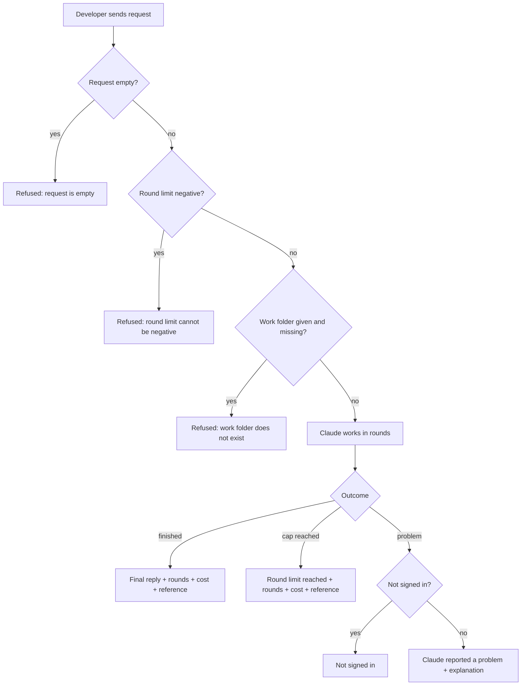

# Product Requirements Document (PRD)

**Status:** Finalized
**Version:** v1.0
**Owner:** CodeMachine0121
**Stakeholders:** Library maintainers, open-source developers who build on the library

---

## 1. Background & Goal (Why & Goal)

- **Problem Statement:** After the first iteration a developer can confirm Claude Code is ready and the person is signed in, but cannot yet ask Claude anything. Developers need to hand Claude a single request — possibly one Claude has to work on over several rounds — and get one complete answer back, with enough information to account for it and to continue later.
- **Expected Outcome:**
  - One call sends a one-shot request and returns the final reply.
  - The developer can cap the rounds Claude may take, and is told clearly when the cap stopped Claude early.
  - Every reply reports rounds used, cost and a conversation reference; the reference continues the conversation in a later request.
  - Every situation in Section 3 is covered by an automated check.
- **Out of Scope:**
  - Intermediate drafts or partial text while Claude works.
  - A library-driven draft-review-improve loop.
  - Conversations kept open across several requests on one connection, and interrupting them (next iteration).
  - Asking the person for permission during the request; actions are allowed up front or not at all.
  - Custom instructions for Claude, extensions and outside tool servers.

---

## 2. User Personas

- **Primary Role(s):**
  - **Developer** — writes the Go program and sends requests through the library.
  - **Person** — runs the program; their Claude Code sign-in (or the handed-over pass or key) pays for the request.
- **Usage Context:** Scripts, command-line tools, back-end jobs and automation that need one answer per request, interactively or unattended.

---

## 3. User Stories & Acceptance Criteria

### US-01 — Get a final reply [priority: P0]
**As a** developer, **I want** to send one request and get Claude's final reply, **so that** my program can use the answer directly.

```gherkin
Scenario: A request gets a final reply
  Given the person is signed in
  When the developer sends the request "Reply with exactly: OK"
  Then the reply text is "OK"
  And the rounds used are 1
  And a cost and a conversation reference are reported

Scenario: An empty request is refused
  Given the request is only spaces
  When the developer sends it
  Then it is refused as "the request is empty"
  And nothing is sent to Claude
```

### US-02 — Cap the rounds [priority: P0]
**As a** developer, **I want** to cap how many rounds Claude may take, **so that** a request cannot run away with time or usage.

```gherkin
Scenario: Claude finishes within the cap
  Given a round limit of 5
  And Claude finishes the request in 3 rounds
  When the developer sends the request
  Then the final reply is returned
  And the rounds used are 3

Scenario: The cap is reached before Claude finishes
  Given a round limit of 1
  And Claude must run a command before it can answer, needing a second round
  When the developer sends the request
  Then the request fails as "round limit reached"
  And the failure reports the rounds used, the cost so far and the conversation reference

Scenario: No cap means Claude Code's usual behaviour
  Given no round limit is given, or a round limit of 0
  When the developer sends the request
  Then Claude Code is not told any round limit

Scenario: A negative cap is refused
  Given a round limit of -1
  When the developer sends the request
  Then it is refused as "the round limit cannot be negative"
  And nothing is sent to Claude
```

### US-03 — Choose how Claude works [priority: P1]
**As a** developer, **I want** to choose the model, the project folder and the actions Claude may take without asking, **so that** the request fits my task.

```gherkin
Scenario: A chosen model answers
  Given the developer chooses the model "haiku"
  When the developer sends the request
  Then Claude Code is told to answer with "haiku"

Scenario: Claude works in the chosen project folder
  Given the developer chooses an existing project folder
  When the developer sends the request
  Then Claude Code works inside that project folder

Scenario: Allowed actions run without asking
  Given the developer allows running commands
  When the developer sends a request that needs a command
  Then Claude Code is told that running commands is allowed without asking

Scenario: A project folder that does not exist is refused
  Given the developer chooses a project folder that does not exist
  When the developer sends the request
  Then it is refused as "the work folder does not exist"
  And nothing is sent to Claude

Scenario: An unavailable model is reported with Claude's explanation
  Given the developer chooses the model "no-such-model"
  When the developer sends the request
  Then the request fails as "claude reported a problem"
  And the failure includes Claude's explanation mentioning "no-such-model"
```

### US-04 — Continue a conversation [priority: P1]
**As a** developer, **I want** a later request to continue an earlier conversation, **so that** Claude keeps the context.

```gherkin
Scenario: A later request continues the conversation
  Given an earlier request in which Claude replied "OK"
  When the developer asks "What did you just reply? Answer in one word." in that conversation
  Then the reply text contains "OK"
  And the conversation reference is unchanged

Scenario: An unknown conversation is refused
  Given a conversation reference that never existed
  When the developer tries to continue it
  Then the request fails as "conversation not found"
```

### US-05 — Account for the request [priority: P0]
**As a** developer, **I want** the cost reported exactly, **so that** my program can track spending without rounding errors.

```gherkin
Scenario: The cost is reported as Claude Code states it
  Given Claude Code states the request cost 0.00559738 dollars
  When the reply arrives
  Then the reported cost reads "0.00559738" dollars

Scenario: Digits beyond the billionth of a dollar are dropped
  Given Claude Code states the request cost 0.0055135800000000006 dollars
  When the reply arrives
  Then the reported cost reads "0.00551358" dollars
```

### US-06 — Sign-in, giving up and secrets [priority: P0]
**As a** developer, **I want** requests to fail clearly when the person is not signed in, stop when I give up, and never repeat a handed-over secret, **so that** my program stays predictable and safe.

```gherkin
Scenario: A person who is not signed in
  Given the person is not signed in and no pass or key was handed over
  When the developer sends a request
  Then the request fails as "not signed in"

Scenario: The developer gives up while Claude works
  Given Claude is still working on a request
  When the developer gives up
  Then Claude Code stops within one second
  And the request is reported as given up

Scenario: A handed-over pass never appears in a failure
  Given the developer handed over the subscription pass "sk-ant-oat01-SECRET"
  And Claude's explanation of a problem contains "sk-ant-oat01-SECRET"
  When the failure reaches the developer
  Then the failure does not contain "sk-ant-oat01-SECRET"
  And the spot is marked "[REDACTED]"
```

---

## 4. Business Flow & Logic

- **Flow Diagram:**



- **Core Business Rules:**
  - A request is empty when it holds nothing but spaces or line breaks.
  - A round limit of 0 means none: Claude Code is not told any limit. A negative limit is refused.
  - Only the final reply is returned; nothing in between.
  - The cost is kept to the billionth of a dollar and never handled as a floating-point number; digits beyond are dropped, not rounded.
  - Every request runs under the profile, pass or key chosen when the library was prepared.
  - The request is handed to Claude Code in a way that works for very long requests on every platform (not as a command-line word).
  - "Not signed in" is recognised from Claude's explanation ("Not logged in"); every other problem keeps Claude's explanation.
  - Handed-over secrets are hidden in every text that reaches the developer.
- **Edge Cases:**
  - Claude Code disappears before the request → "Claude Code is not installed".
  - Claude Code's answer cannot be understood → "could not read the reply", including what it said (secrets hidden).
  - The round limit is reached: no final reply exists, but rounds, cost and reference are still reported.

---

## 5. UI/UX Design & Interaction

- **Prototype Link:** N/A — the library has no screens.
- **Key Interactions:** Refusals and failures read as short plain sentences; failures that carry rounds, cost and conversation reference let the developer decide to continue.

---

## 6. Non-Functional Requirements

- **Performance:** The library adds no noticeable time beyond Claude Code's own; giving up stops Claude Code within one second.
- **Security:** Handed-over secrets never appear in failures. Nothing the person types or Claude replies is logged by the library.
- **Compatibility:** Same as the first iteration: Claude Code 2.1.0+, Linux / macOS / Windows, the two most recent Go releases. Very long requests work on every platform.
- **Dependencies:** No third-party code is compiled into the developer's program; the cost is handled exactly without an outside decimal library.
- **Analytics / Tracking:** None.

---

## 7. Dependencies & Risks

- **External Dependencies:** Claude Code 2.1.0 or later; the person's sign-in or a handed-over pass or key.
- **Known Risks:**
  - Every automated check that reaches Claude uses the person's usage; integration checks keep requests tiny and use the fastest model.
  - "Not signed in" is recognised from Claude's wording, which may change; the fallback is still a clear "claude reported a problem" with the explanation.
  - Allowing actions lets Claude change files or run commands in the work folder; documentation must say so.

---

## 8. Appendix

- Requirements brief: `BRIEF.md` in this folder. Domain vocabulary: `.sdd/UL-MAP.md`.
- Previous iteration: `.sdd/2026-11-26-cli-auth-profiles/`.
- Observed Claude Code 2.1.332: the final answer reports `num_turns`, `total_cost_usd`, `session_id`, an outcome (`success`, `error_max_turns`) and an error flag with Claude's explanation; an unknown conversation is rejected with "No conversation found with session ID" and no structured answer.
