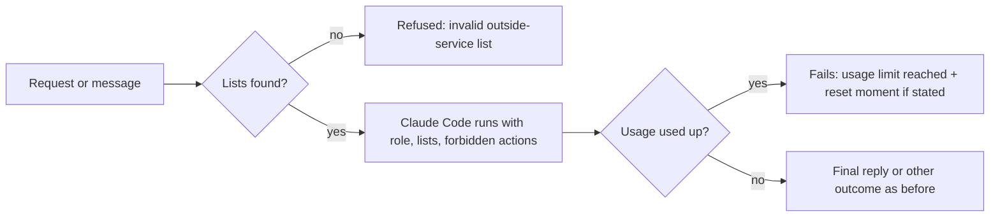

# Product Requirements Document (PRD)

**Status:** Finalized
**Version:** v1.0
**Owner:** CodeMachine0121
**Stakeholders:** Library maintainers, developers building agent teams on the library

---

## 1. Background & Goal (Why & Goal)

- **Problem Statement:** A platform runs teams of Claude agents that share one Claude subscription; each agent has its own project folder, role, outside services and forbidden actions. Today a request cannot carry a role, outside services or forbidden actions, and a used-up subscription looks like any other problem, so a scheduler retries in vain instead of pausing until the usage resets.
- **Expected Outcome:**
  - A used-up subscription is reported as "usage limit reached", with the reset moment whenever Claude Code states one, for one-shot requests and for every message of a conversation.
  - One-shot requests and conversations can carry outside-service lists (optionally to the exclusion of the person's own), forbidden actions and role instructions.
  - Leaving the new choices out changes nothing for existing programs.
  - Every scenario in Section 3 is covered by an automated check.
- **Out of Scope:** waiting or retrying automatically; outside-service lists given as words in the request; replacing Claude's usual instructions entirely; reporting remaining usage before the limit.

---

## 2. User Personas

- **Developer** — builds an agent platform or scheduler on the library.
- **Person** — owns the shared subscription whose usage is spent.
- **Usage Context:** unattended services that run many agents for hours; each agent in its own project folder.

---

## 3. User Stories & Acceptance Criteria

### US-01 — Recognise a used-up subscription [priority: P0]
**As a** developer, **I want** a distinct "usage limit reached" failure with the reset moment, **so that** my scheduler pauses until the reset instead of retrying.

```gherkin
Scenario: A one-shot request refused by the usage limit reports the reset moment
  Given the subscription's usage is used up
  And Claude Code states it comes back at 15:00 UTC on 27 November 2026
  When the developer sends a one-shot request
  Then the request fails as "usage limit reached"
  And the failure says the usage comes back at 15:00 UTC on 27 November 2026

Scenario: No reset moment is invented when Claude Code states none
  Given the subscription's usage is used up
  And Claude Code does not state when it comes back
  When the developer sends a one-shot request
  Then the request fails as "usage limit reached"
  And the failure gives no reset moment

Scenario: A conversation message refused by the usage limit leaves the conversation open
  Given an open conversation
  And the subscription's usage is used up, coming back at 15:00 UTC on 27 November 2026
  When the developer sends a message
  Then the message fails as "usage limit reached" with the reset moment 15:00 UTC on 27 November 2026
  And the next message is still sent to Claude

Scenario: Another problem is never mistaken for the usage limit
  Given Claude reports that the chosen model is unavailable
  When the developer sends a request
  Then the request fails as "Claude reported a problem"
  And it is not reported as "usage limit reached"

Scenario: Usage close to the limit is not a failure
  Given the subscription's usage is close to the limit but not used up
  When the developer sends a request
  Then Claude's final reply is returned
```

### US-02 — Give an agent its outside services [priority: P0]
**As a** developer, **I want** to hand each agent its own outside-service lists, optionally excluding the person's own services, **so that** every agent sees exactly the services of its role.

```gherkin
Scenario: Only the listed outside services are used
  Given an outside-service list naming no services
  And only the given lists are to be used
  When the developer sends a request
  Then Claude connects to no outside service

Scenario: Listed services join the person's own
  Given an outside-service list
  And the person's own services are not excluded
  When the developer sends a request
  Then Claude can use the listed services and the person's own

Scenario: A list that cannot be found is refused before starting
  Given an outside-service list that does not exist
  When the developer sends a request or opens a conversation
  Then it is refused as "invalid outside-service list" before Claude Code starts

Scenario: A list that cannot be read fails
  Given an outside-service list whose content is not a valid list
  When the developer sends a request
  Then the request fails as "invalid outside-service list"

Scenario: A list named by its place in the project is found in the work folder
  Given a work folder containing the outside-service list "tools.json"
  When the developer sends a request naming "tools.json"
  Then the list in the work folder is used
```

### US-03 — Forbid actions [priority: P0]
**As a** developer, **I want** to name actions an agent must never take, **so that** a reviewer agent cannot change files.

```gherkin
Scenario: Forbidden actions are unavailable
  Given editing and writing files are forbidden
  When the developer sends a request
  Then Claude has no way to edit or write files

Scenario: Nothing forbidden keeps every action
  Given no forbidden actions
  When the developer sends a request
  Then Claude can still edit and write files
  And no action is withheld from Claude by the request
```

### US-04 — Give an agent its role [priority: P0]
**As a** developer, **I want** to add role instructions on top of Claude's usual instructions, **so that** each agent behaves as its role.

```gherkin
Scenario: Role instructions are followed
  Given role instructions "The codeword is PELICAN."
  When the developer asks "What is the codeword? Reply with only the codeword."
  Then Claude's final reply is "PELICAN"

Scenario: No role instructions keeps the usual instructions
  Given no role instructions
  When the developer asks "What is the codeword? Reply with only the codeword."
  Then Claude's final reply is not "PELICAN"
  And no role instructions are handed to Claude

Scenario: A continued conversation keeps the role it began with
  Given an earlier conversation began with role instructions A
  When the developer continues it with role instructions B
  Then Claude keeps following role instructions A
```

### US-05 — Same choices for conversations [priority: P0]
**As a** developer, **I want** conversations to take the same four choices, **so that** long-running agents are configured like one-shot ones.

```gherkin
Scenario: A conversation carries every choice
  Given outside-service lists, only-listed mode, forbidden actions and role instructions
  When the developer opens a conversation with them
  Then every message of the conversation is answered under those choices
```

---

## 4. Business Flow & Logic



- **Core Business Rules:**
  - "Usage limit reached" is recognised from Claude Code's own statement of the cause, never guessed from a similar-looking problem.
  - The reset moment is the one Claude Code states for the refused request; when it states none, none is given.
  - The usage-limit failure keeps the conversation reference, rounds and cost, like the round-limit failure.
  - A conversation stays open after a usage-limit failure.
  - Outside-service lists named by their place in the project are found from the work folder (the program's current folder when none is chosen).
  - Missing lists are refused before Claude Code starts; unreadable lists fail as the same "invalid outside-service list".
  - Empty choices are not passed on; existing behaviour is unchanged.
  - Handed-over secrets stay hidden in every failure.
- **Edge Cases:** a usage limit that appears mid-conversation after earlier replies; usage-limit notices that are only warnings are ignored.

---

## 5. UI/UX Design & Interaction

N/A — no screens. Failures read as short plain sentences.

---

## 6. Non-Functional Requirements

- **Performance:** no extra Claude Code start; one-shot answers are read as they arrive without keeping the whole working transcript.
- **Security:** secrets never appear in failures; nothing is logged.
- **Compatibility:** Claude Code 2.1.332 and later; older wording of the usage-limit refusal is tolerated where recognisable.
- **Dependencies:** none beyond the standard library in production code.

---

## 7. Dependencies & Risks

- The reset moment is only visible in Claude Code's detailed answer stream, so one-shot requests switch to that stream; a large transcript must not be held in memory.
- A usage limit cannot be produced on demand, so its checks use recorded Claude Code answers.
- Role instructions are recorded by Claude Code when a conversation begins; a continued conversation ignores new ones (Claude Code behaviour, documented).

---

## 8. Appendix

- Requirements brief: `BRIEF.md` in this folder; previous iterations under `.sdd/`.
- Observed Claude Code 2.1.332: final answer carries `is_error`, `api_error_status` 429 and `api_error: usage_limit_reached`; the reset moment (unix seconds) arrives on the refused assistant message (`api_error_params.rate_limit_info.resetsAt`) and on a `rate_limit_event` with status `rejected`; a missing or invalid list prints "Invalid MCP configuration" and exits before any request.
